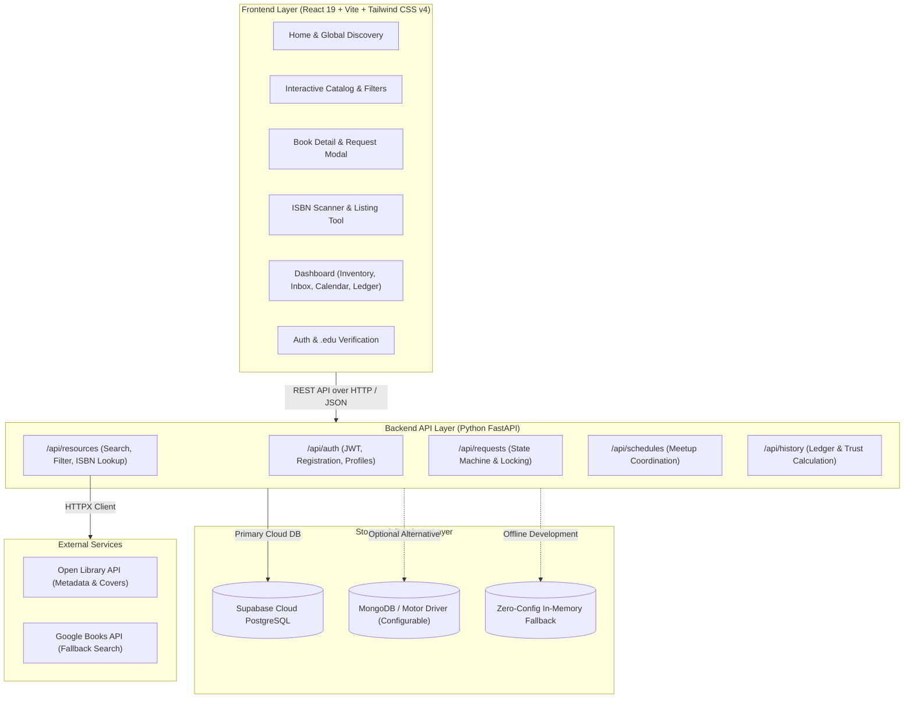
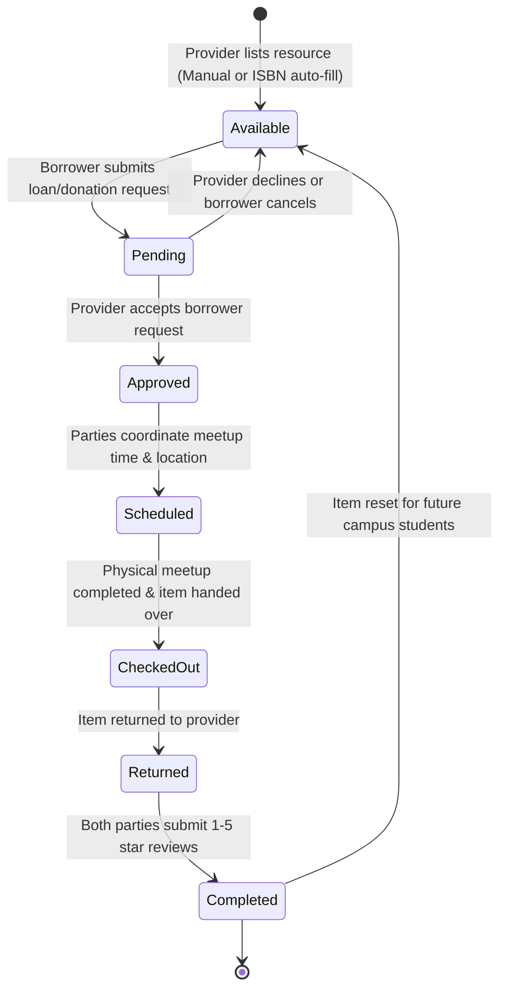
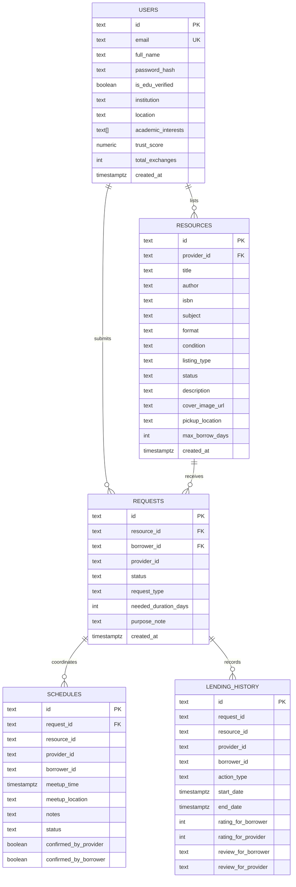

# 📚 BookBridge (EduShare)

> **A centralized, peer-to-peer web platform designed to eliminate educational inequality by connecting students with surplus books and learning materials to those in need.**

[](https://opensource.org/licenses/MIT)
[](https://fastapi.tiangolo.com)
[](https://react.dev)
[](https://vitejs.dev)
[](https://tailwindcss.com)
[](https://supabase.com)

---

## 📑 Table of Contents

- [Problem Statement](#-problem-statement)
- [The Solution](#-the-solution)
- [System Architecture](#-system-architecture)
- [User Journeys & Application Flow](#-user-journeys--application-flow)
- [Tech Stack](#-tech-stack)
- [Core Features](#-core-features)
- [Database Schema](#-database-schema)
- [API Reference](#-api-reference)
- [Installation & Quick Start](#-installation--quick-start)
- [Demo Personas](#-demo-personas)
- [Project Structure](#-project-structure)

---

## 🎯 Problem Statement

There is a fundamental imbalance in the distribution of educational resources within academic communities:

1. **Surplus Without Outlets:** Hundreds of thousands of college students, graduates, and educators finish their courses each semester with expensive, barely used textbooks, lab manuals, and revision kits sitting dormant on shelves.
2. **Artificial Economic Barriers:** Simultaneously, incoming students face exorbitant textbook costs—often exceeding **\$1,200 per academic year**—forcing many to take classes without required literature or compromise their academic performance.
3. **Absence of Trust & Coordination:** Existing buyback programs offer pennies on the dollar, while generic online marketplaces lack academic verification, physical handover coordination, and peer accountability mechanisms.

---

## 💡 The Solution

**BookBridge (EduShare)** bridges this community divide through an open, hyper-local lending and donation ecosystem tailored specifically for campuses:

* 📖 **Automated ISBN Cataloging:** Providers enter any 10 or 13-digit barcode; BookBridge automatically retrieves the title, authors, edition, subject, and high-resolution cover photo from Open Library and Google Books APIs.
* 🔍 **Rich Multi-Filter Discovery:** Students can instantly search by title, author, or course keyword, and refine results by Subject, Physical Condition, Format, Lending vs. Free Donation, and Availability.
* 🔒 **Transactional Item Locking:** Once a provider approves a request, the resource is atomically locked to prevent double checkout or conflicting requests.
* 📅 **Physical Collection Scheduling:** Integrated calendar coordination allows counterparties to agree on safe campus meeting spots (e.g., Campus Library Desk, Student Union) with automated reminders.
* ⭐ **Accountability Ledger & Trust Scores:** Every completed exchange updates a permanent trust history with 1–5 star reviews, verified `.edu` badges, and reliability metrics.

---

## 🏛️ System Architecture

BookBridge utilizes a modern, decoupled client-server architecture powered by a high-performance RESTful API, asynchronous task handling, and flexible cloud database storage:



---

## 🔄 User Journeys & Application Flow

### 1. The Lending & Donation Lifecycle



### 2. Comprehensive User Flows

#### 👩‍🎓 Student Borrower Journey
1. **Discover:** Searches for a course textbook via global search or catalog filters (e.g., "Computer Science", "Available Only").
2. **Evaluate:** Inspects book condition, provider's verified `.edu` status, campus location, and trust score.
3. **Request:** Selects desired loan period (e.g., 14 days) or claims a free donation, adding an optional course note.
4. **Coordinate:** Proposes or confirms a convenient campus collection meetup point.
5. **Receive & Return:** Meets the peer on campus, completes studies, returns the book, and rates the interaction to boost community trust.

#### 👨‍🏫 Resource Provider Journey
1. **Scan / Enter:** Types or scans the 10/13-digit ISBN; book metadata and cover populate in seconds.
2. **Configure:** Sets exchange type (Lend vs. Free Donation), physical condition, pickup campus spot, and max loan days.
3. **Review Inbox:** Receives borrow requests with the requester’s academic profile and trust score; approves or declines.
4. **Handover:** Coordinates time at the library or student lounge, hands over the textbook.
5. **Close:** Confirms the return upon completion and leaves a peer rating.

---

## 🛠️ Tech Stack

| Layer | Technology | Purpose |
| :--- | :--- | :--- |
| **Frontend** | [React 19](https://react.dev/) | Component-driven, responsive user interface |
| **Build Tool** | [Vite 8](https://vitejs.dev/) | Lightning-fast HMR and optimized production bundle (<1s build) |
| **Styling** | [Tailwind CSS v4](https://tailwindcss.com/) | Modern utility-first CSS styling |
| **Icons** | [Lucide React](https://lucide.dev/) | Clean, accessible SVG iconography |
| **Routing** | [React Router v7](https://reactrouter.com/) | Client-side declarative application routing |
| **HTTP Client** | [Axios](https://axios-http.com/) | Interceptor-managed API calls with automatic JWT Bearer headers |
| **Backend API** | [FastAPI](https://fastapi.tiangolo.com/) | High-performance Python 3.11 asynchronous REST API |
| **Validation** | [Pydantic v2](https://docs.pydantic.dev/) | Robust data validation and schema serialization |
| **Primary DB** | [Supabase PostgreSQL](https://supabase.com/) | Real-time cloud relational database with row-level security |
| **Alternative DB** | [MongoDB](https://www.mongodb.com/) / [Motor](https://motor.readthedocs.io/) | Asynchronous document storage support |
| **Security** | [Bcrypt](https://pypi.org/project/bcrypt/) & [Python-Jose](https://github.com/mpdavis/python-jose) | Salted password hashing and secure stateless JWT sessions |
| **External APIs** | [Open Library](https://openlibrary.org/developers/api) & [Google Books](https://developers.google.com/books) | Automated metadata, publisher info, and cover fetching by ISBN |

---

## 🌟 Core Features

### 1. ISBN Scanner & Listing Capabilities
- Instant barcode lookup querying Open Library and Google Books REST endpoints.
- Auto-populates Title, Author, Cover image, Subject, and Edition.
- Categorizes by Subject, Physical Condition (`Brand New`, `Like New`, `Good`, `Fair`, `Poor`), Format (`Textbook`, `Hardcover`, `Paperback`, `Study Notes`), and Intent (`Lend` vs `Donate`).

### 2. Searchable Resource Catalog
- Real-time debounced query search across titles, authors, keywords, and ISBNs.
- Multi-filter sidebar with interactive chips and one-click reset.
- Live availability indicator (`Available`, `Borrowed`, `Pending`, `Donated`).

### 3. Request Management & Locking
- Borrowers request with customized duration sliders and course notes.
- Provider inbox with one-click **Approve** and **Decline** actions.
- Automatic item locking upon approval to prevent double-lending.

### 4. Collection Scheduling
- Propose meeting date, time, physical campus landmark, and contact instructions.
- Mutual attendance confirmation status (`proposed` → `confirmed`).

### 5. Lending Ledger & Dynamic Trust Score
- Immutable audit trail of completed book loans and donations.
- Interactive 5-star rating modal with qualitative reviews.
- Dynamic algorithm automatically recalculating user trust scores (1.0 to 5.0).

---

## 🗄️ Database Schema

BookBridge runs natively on Supabase PostgreSQL (or MongoDB/in-memory store) across 5 core tables:



---

## 📡 API Reference

Interactive OpenAPI / Swagger documentation is available at **`http://localhost:8000/docs`**.

### Authentication
| Method | Endpoint | Description |
| :--- | :--- | :--- |
| `POST` | `/api/auth/register` | Register new user; auto-flags `.edu` emails |
| `POST` | `/api/auth/login` | Authenticate and retrieve JWT Bearer token |
| `GET` | `/api/auth/me` | Fetch authenticated student profile |
| `PUT` | `/api/auth/me` | Update campus location, interests, and bio |

### Resources & Catalog
| Method | Endpoint | Description |
| :--- | :--- | :--- |
| `GET` | `/api/resources` | Query and filter catalog resources |
| `GET` | `/api/resources/{id}` | Retrieve single resource details & provider trust |
| `POST` | `/api/resources` | List a new textbook or study kit |
| `PUT` | `/api/resources/{id}` | Update listing details (Provider only) |
| `DELETE` | `/api/resources/{id}` | Delete listing (Provider only) |
| `GET` | `/api/resources/isbn-lookup/{isbn}` | Auto-fetch metadata from Open Library |

### Requests & Exchanges
| Method | Endpoint | Description |
| :--- | :--- | :--- |
| `POST` | `/api/requests` | Submit borrow or donation claim |
| `GET` | `/api/requests/incoming` | Provider inbox of received requests |
| `GET` | `/api/requests/outgoing` | Borrower tracking of submitted requests |
| `PUT` | `/api/requests/{id}/approve` | Accept request & lock resource |
| `PUT` | `/api/requests/{id}/reject` | Decline request |
| `PUT` | `/api/requests/{id}/complete-return` | Mark returned, unlock resource & log to history |

### Meetup Scheduling & History
| Method | Endpoint | Description |
| :--- | :--- | :--- |
| `POST` | `/api/schedules` | Propose physical collection meetup |
| `GET` | `/api/schedules` | Retrieve user's scheduled handovers |
| `PUT` | `/api/schedules/{id}/confirm` | Confirm meetup attendance |
| `GET` | `/api/history` | Retrieve completed exchanges ledger |
| `POST` | `/api/history/review` | Submit peer review & update trust score |
| `GET` | `/api/history/metrics/overview` | High-level platform impact metrics |

---

## 🚀 Installation & Quick Start

### 1. Prerequisites
- **Node.js**: v18.0+
- **Python**: v3.10+
- **Git**

### 2. Clone the Repository
```bash
git clone https://github.com/chandru07072007/Book.git
cd Book
```

### 3. Quick Run Options

#### Option A: Windows 1-Click Launchers
- Backend: Double-click [`run_backend.bat`](run_backend.bat)
- Frontend: Double-click [`run_frontend.bat`](run_frontend.bat)

#### Option B: Terminal Setup

**Start Backend:**
```bash
# Set up virtual environment
python -m venv venv
.\venv\Scripts\activate   # On Windows (source venv/bin/activate on macOS/Linux)

# Install dependencies
pip install -r backend/requirements.txt

# Launch FastAPI server
cd backend
python -m uvicorn app.main:app --host 127.0.0.1 --port 8000 --reload
```

**Start Frontend:**
```bash
# In a new terminal window
cd frontend
npm install
npm run dev
```

Visit **`http://localhost:5173`** in your browser!

---

## 👥 Demo Personas

For rapid testing, pre-seeded accounts with verified status and sample listings are available directly via 1-click buttons on the Login page:

| Persona | Email | Password | Role |
| :--- | :--- | :--- | :--- |
| **Alice Johnson** | `alice@campus.edu` | `password123` | CS Senior & Textbook Provider (Stanford) |
| **Bob Martinez** | `bob@campus.edu` | `password123` | Physics Graduate Student & Borrower (Stanford) |

---

## 📂 Project Structure

```
Book/
├── backend/
│   ├── app/
│   │   ├── config.py              # Environment configuration & JWT settings
│   │   ├── database.py            # Supabase Cloud & MongoDB unified DB engine
│   │   ├── main.py                # FastAPI initialization, CORS, and lifespan
│   │   ├── models/                # Pydantic validation schemas
│   │   │   ├── history.py
│   │   │   ├── request.py
│   │   │   ├── resource.py
│   │   │   ├── schedule.py
│   │   │   └── user.py
│   │   ├── routers/               # Modular REST API endpoints
│   │   │   ├── auth.py
│   │   │   ├── history.py
│   │   │   ├── requests.py
│   │   │   ├── resources.py
│   │   │   └── schedules.py
│   │   └── services/              # Business logic & external APIs
│   │       ├── auth_service.py    # Password hashing & JWT token management
│   │       ├── isbn_service.py    # Open Library & Google Books API client
│   │       └── seed_data.py       # Realistic textbook seed data generator
│   ├── requirements.txt           # Python backend dependencies
│   └── .env.example
├── frontend/
│   ├── src/
│   │   ├── components/            # Reusable UI components
│   │   │   ├── BookCard.jsx
│   │   │   ├── FilterSidebar.jsx
│   │   │   ├── Footer.jsx
│   │   │   ├── Navbar.jsx
│   │   │   ├── RequestModal.jsx
│   │   │   ├── ReviewModal.jsx
│   │   │   └── ScheduleModal.jsx
│   │   ├── context/
│   │   │   └── AuthContext.jsx    # User session & state management
│   │   ├── pages/                 # Application views
│   │   │   ├── AddBookPage.jsx    # ISBN scan & listing creator
│   │   │   ├── BookDetailPage.jsx # Item inspection & loan trigger
│   │   │   ├── CatalogPage.jsx    # Search & multi-filter directory
│   │   │   ├── DashboardPage.jsx  # Multi-tab exchange hub
│   │   │   ├── HomePage.jsx       # Hero, metrics, and workflow guide
│   │   │   ├── LoginPage.jsx      # Clean authentication & 1-click demos
│   │   │   └── RegisterPage.jsx   # Structured onboarding with .edu detection
│   │   ├── services/
│   │   │   ├── api.js             # Axios client with JWT interceptor
│   │   │   └── supabase.js        # Supabase JavaScript client
│   │   ├── App.jsx                # Route declarations
│   │   ├── index.css              # Tailwind v4 directives & input classes
│   │   └── main.jsx
│   ├── package.json
│   └── vite.config.js
├── supabase_schema.sql            # Ready-to-run PostgreSQL schema for Supabase
├── run_backend.bat                # Windows 1-click backend launcher
├── run_frontend.bat               # Windows 1-click frontend launcher
├── .gitignore
└── README.md
```

---

## 📄 License

This project is open-source and distributed under the **MIT License**. See `LICENSE` for details.
