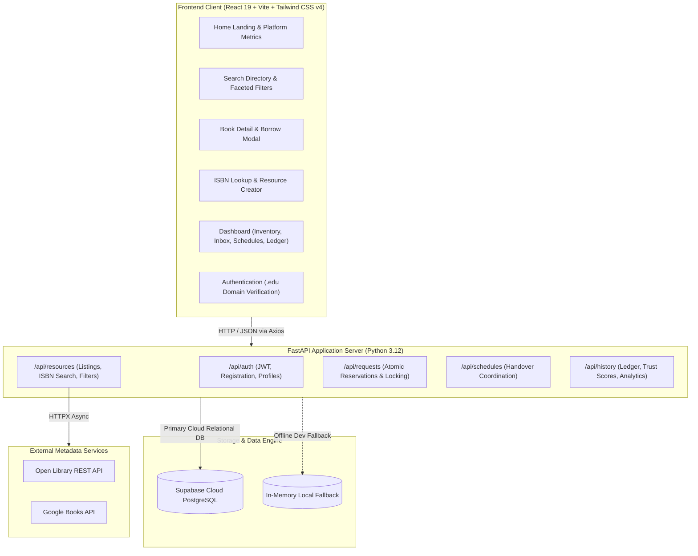
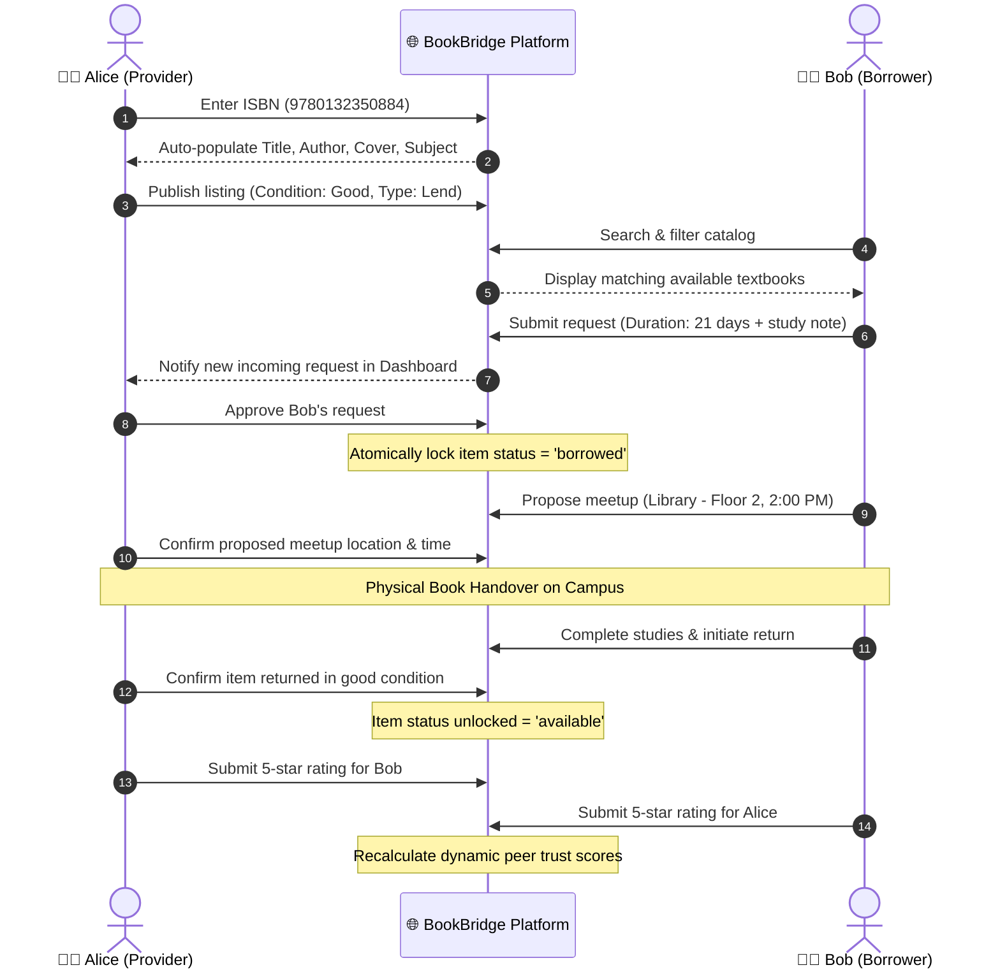
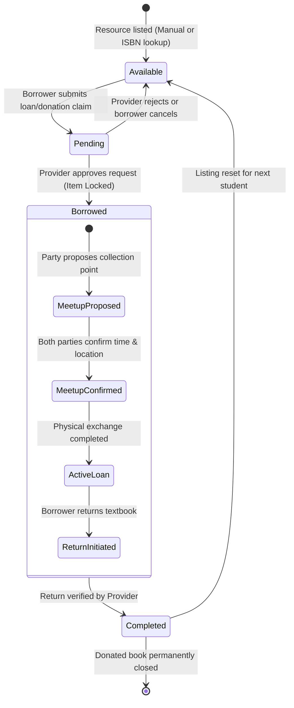
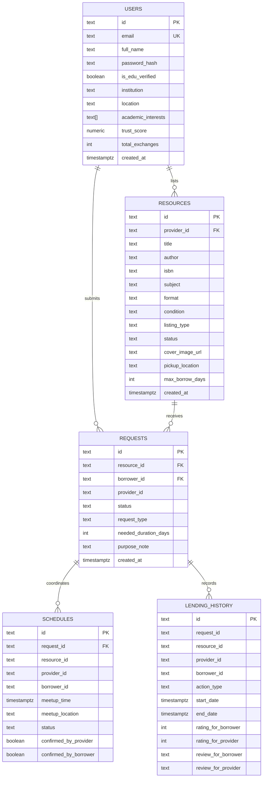

<div align="center">

# 📚 BookBridge (EduShare)
### Peer-to-Peer Educational Resource Sharing & Campus Textbook Exchange

[](https://opensource.org/licenses/MIT)
[](https://python.org)
[](https://fastapi.tiangolo.com)
[](https://react.dev)
[](https://vitejs.dev)
[](https://tailwindcss.com)
[](https://supabase.com)
[](https://vercel.com)

<p align="center">
  <b>Eliminating academic financial barriers by connecting students with surplus textbooks to peers in need.</b>
</p>

[Documentation](#-table-of-contents) •
[Quick Start](#-quick-start--local-setup) •
[System Architecture](#-system-architecture) •
[API Reference](#-api-reference) •
[Deployment Guide](#-deployment-guide)

</div>

---

## 📑 Table of Contents

- [Executive Summary](#-executive-summary)
- [Problem Statement & Impact](#-problem-statement--impact)
- [The BookBridge Solution](#-the-bookbridge-solution)
- [System Architecture](#-system-architecture)
- [User Workflows & Sequence Flow](#-user-workflows--sequence-flow)
- [State Machine & Transaction Logic](#-state-machine--transaction-logic)
- [Tech Stack](#-tech-stack)
- [Core Features](#-core-features)
- [Database Schema (ERD)](#-database-schema-erd)
- [API Reference](#-api-reference)
- [Quick Start & Local Setup](#-quick-start--local-setup)
- [Deployment Guide](#-deployment-guide)
- [Demo Accounts](#-demo-accounts)
- [Project Directory Structure](#-project-directory-structure)
- [Security & Data Integrity](#-security--data-integrity)
- [License](#-license)

---

## 📌 Executive Summary

**BookBridge (EduShare)** is an open-source, full-stack peer-to-peer web platform built for college and university campuses. It addresses the rising crisis of textbook affordability by enabling students to lend or donate course literature, lab manuals, and exam guides directly to peers. 

By combining **automated ISBN metadata lookup**, **transactional resource locking**, **in-app campus meetup scheduling**, and a **peer-verified trust ledger**, BookBridge makes educational resource sharing transparent, accountable, and frictionless.

---

## 🎯 Problem Statement & Impact

### The Academic Resource Bottleneck
1. **Exorbitant Textbook Costs:** College students spend an average of **\$1,200 to \$1,500 annually** on course textbooks. Many are forced to delay purchases, skip required materials, or alter course paths due to financial constraints.
2. **Dormant Academic Surplus:** At the conclusion of each academic quarter or semester, thousands of textbooks sit neglected on dorm shelves or end up in landfills.
3. **Flawed Traditional Channels:** Campus bookstores offer fraction-of-dollar buybacks (often under 10% of retail price), while non-academic marketplaces lack identity verification, physical campus rendezvous coordination, and peer trust guarantees.

> [!IMPORTANT]
> **Goal:** Create an autonomous, hyper-local campus network that eliminates out-of-pocket textbook expenses and ensures 100% textbook lifecycle circularity.

---

## 💡 The BookBridge Solution

```
┌─────────────────────────────────────────────────────────────────────────────┐
│                           The BookBridge Advantage                          │
├──────────────────────┬──────────────────────┬───────────────────────────────┤
│ ⚡ Auto ISBN Scan    │ 🤝 Campus Trust Web  │ 🔒 Transactional Integrity    │
│ 1-Click metadata     │ Verified .edu emails │ Atomic item locking prevents  │
│ ingestion from Open  │ and dynamic 1.0–5.0  │ double loans, conflicts, or   │
│ Library & Google.    │ peer trust scores.   │ unauthorized claims.          │
├──────────────────────┼──────────────────────┼───────────────────────────────┤
│ 📅 Meetup Scheduling │ 🎁 Dual Intent       │ 📊 Immutable Ledger           │
│ Coordinated campus   │ Flexible options for │ Complete historical record    │
│ landmarks (Library,  │ temporary borrowing  │ of all loans, returns, and    │
│ Union, Quad).        │ or permanent gift.   │ bilateral peer reviews.       │
└──────────────────────┴──────────────────────┴───────────────────────────────┘
```

---

## 🏛️ System Architecture

BookBridge is structured as a decoupled, multi-tier system with modern cloud data persistence:



---

## 🔄 User Workflows & Sequence Flow

The end-to-end exchange lifecycle involves two student personas: the **Resource Provider** (book owner) and the **Borrower** (student in need).



---

## ⚙️ State Machine & Transaction Logic

Book listings and loan requests undergo strict state transitions to guarantee transaction safety:



---

## 🛠️ Tech Stack

### Frontend Architecture
| Package / Tool | Version | Purpose |
| :--- | :--- | :--- |
| **React** | `19.0.0` | Core declarative UI component library |
| **Vite** | `8.3.4` | High-performance build tool and dev server (<500ms builds) |
| **Tailwind CSS** | `v4.0` | Next-gen CSS-first styling framework |
| **React Router** | `v7.2` | Client-side routing with nested routes and state management |
| **Lucide React** | `^1.16` | Modern, clean vector icon suite |
| **Axios** | `^1.8` | Interceptor-driven HTTP client with automated Bearer tokens |

### Backend Architecture
| Package / Tool | Version | Purpose |
| :--- | :--- | :--- |
| **FastAPI** | `>=0.110.0` | High-throughput asynchronous Python REST framework |
| **Python** | `3.12 / 3.11` | Modern asynchronous runtime |
| **Uvicorn** | `>=0.28.0` | Lightning-fast ASGI web server implementation |
| **Pydantic** | `v2.6+` | Strict schema validation, parsing, and serialization |
| **Supabase Client** | `^2.3.0` | PostgREST connection engine for PostgreSQL database |
| **HTTPX** | `>=0.27.0` | Async HTTP client for external ISBN metadata queries |
| **Bcrypt & Jose** | `Latest` | Salted password hashing & stateless JWT session generation |

---

## 🌟 Core Features

### 1. 🔍 Automated ISBN Cataloging
- Enter any 10 or 13-digit ISBN barcode.
- Automatically retrieves title, author, edition, academic subject, description, and high-resolution book cover from **Open Library** and **Google Books**.
- Eliminates manual typing errors and standardizes catalog data.

### 2. 🗂️ Faceted Search & Filtering
- Live debounced search across book titles, authors, descriptions, and ISBNs.
- Filter by Subject, Format, Condition, Intent (Lend vs. Donate), and Status.

### 3. 🔒 Transactional Integrity & Resource Locking
- Eliminates double-booking. When a provider accepts a borrow request, the resource is atomically locked to the borrower.
- Real-time badges notify other users that the item is currently in use with expected return dates.

### 4. 📅 Campus Meetup Coordinator
- Propose and confirm safe physical handover points on campus (e.g., Campus Library Desk, Student Union Cafe, Engineering Quad).
- Bilateral attendance confirmation with status indicators (`proposed` → `confirmed`).

### 5. ⭐ Community Trust Ledger & Verified Profiles
- Immutable transaction history recording every completed book exchange.
- Bilateral 5-star rating system with written feedback.
- Dynamic trust score calculation (`1.0` to `5.0`) highlighting verified `.edu` students.

---

## 🗄️ Database Schema (ERD)



---

## 📡 API Reference

Interactive Swagger documentation is available at **`/docs`**.

### 1. Authentication Endpoints (`/api/auth`)
| Method | Endpoint | Access | Description |
| :--- | :--- | :--- | :--- |
| `POST` | `/api/auth/register` | Public | Create new account; auto-detects `.edu` emails |
| `POST` | `/api/auth/login` | Public | Authenticate user; returns JWT Bearer token |
| `GET` | `/api/auth/me` | User | Retrieve current user profile and trust statistics |
| `PUT` | `/api/auth/me` | User | Update profile, academic institution, and interests |

### 2. Resource Management (`/api/resources`)
| Method | Endpoint | Access | Description |
| :--- | :--- | :--- | :--- |
| `GET` | `/api/resources` | Public | Search and filter textbooks with query parameters |
| `GET` | `/api/resources/{id}` | Public | Retrieve single textbook details & provider trust |
| `POST` | `/api/resources` | User | Create new book listing (manual or ISBN populated) |
| `PUT` | `/api/resources/{id}` | Owner | Update listing details, location, or max borrow days |
| `DELETE` | `/api/resources/{id}` | Owner | Remove a listing from the catalog |
| `GET` | `/api/resources/isbn-lookup/{isbn}` | User | Auto-fetch metadata from Open Library & Google Books |

### 3. Requests & Exchange State (`/api/requests`)
| Method | Endpoint | Access | Description |
| :--- | :--- | :--- | :--- |
| `POST` | `/api/requests` | User | Submit a borrow request or donation claim |
| `GET` | `/api/requests/incoming` | User | View all requests received for user's listings |
| `GET` | `/api/requests/outgoing` | User | Track submitted requests and their status |
| `PUT` | `/api/requests/{id}/approve` | Provider | Accept request and atomically lock textbook |
| `PUT` | `/api/requests/{id}/reject` | Provider | Decline borrow request |
| `PUT` | `/api/requests/{id}/complete-return`| Provider | Confirm textbook return, unlock item & log to ledger |

### 4. Schedules & Peer Ledger (`/api/schedules` & `/api/history`)
| Method | Endpoint | Access | Description |
| :--- | :--- | :--- | :--- |
| `POST` | `/api/schedules` | User | Propose physical campus handover meetup |
| `GET` | `/api/schedules` | User | Fetch active handover appointments |
| `PUT` | `/api/schedules/{id}/confirm` | User | Confirm attendance for scheduled meetup |
| `GET` | `/api/history` | User | View completed exchanges ledger |
| `POST` | `/api/history/review` | User | Submit bilateral 1–5 star rating & review |
| `GET` | `/api/history/metrics/overview` | Public | Platform-wide community impact metrics |

---

## 🚀 Quick Start & Local Setup

### Prerequisites
- **Node.js**: v18.0+
- **Python**: v3.11 or v3.12
- **Git**

### 1. Clone the Repository
```bash
git clone https://github.com/chandru07072007/Book.git
cd Book
```

### 2. Option A: Windows 1-Click Launchers
Simply double-click:
1. `run_backend.bat` — Starts the FastAPI backend at `http://127.0.0.1:8000`
2. `run_frontend.bat` — Starts the Vite dev server at `http://localhost:5173`

---

### 3. Option B: Manual Setup

#### Backend Setup
```bash
# 1. Create and activate virtual environment
python -m venv venv

# Windows:
.\venv\Scripts\activate
# macOS / Linux:
source venv/bin/activate

# 2. Install backend dependencies
pip install -r backend/requirements.txt

# 3. Launch FastAPI server
cd backend
python -m uvicorn app.main:app --host 127.0.0.1 --port 8000 --reload
```

#### Frontend Setup
```bash
# In a new terminal window
cd frontend
npm install
npm run dev
```

Visit **`http://localhost:5173`** in your browser. All `/api/*` network requests automatically proxy to the backend at port 8000.

---

## ☁️ Deployment Guide

### Architecture Overview
- **Backend API:** Deployed on **Vercel** (`https://book-brown-one.vercel.app`) using Python 3.12 runtime.
- **Database:** Hosted on **Supabase Cloud PostgreSQL** (`https://sdgszspdgrtbrsvqlzgh.supabase.co`).
- **Frontend Client:** Deployed on **Cloudflare Pages** or **Vercel**.

---

## 👥 Demo Accounts

The database includes pre-seeded verified academic accounts with sample listings for rapid evaluation:

| Persona | Credentials | Campus / Institution | Primary Role |
| :--- | :--- | :--- | :--- |
| **Alice Johnson** | `alice@campus.edu`<br>`password123` | Stanford University | **Textbook Provider**<br>(Has listed CS & Economics books) |
| **Bob Martinez** | `bob@campus.edu`<br>`password123` | Stanford University | **Borrower & Donor**<br>(Has listed Physics & Calculus books) |

---

## 📂 Project Directory Structure

```text
Book/
├── backend/
│   ├── app/
│   │   ├── config.py              # Environment variables & JWT settings
│   │   ├── database.py            # Supabase PostgREST & Mongo DB interface
│   │   ├── main.py                # FastAPI app initialization, CORS, lifespan
│   │   ├── models/                # Pydantic data validation schemas
│   │   ├── routers/               # Modular REST API route handlers
│   │   └── services/              # Core business services
│   ├── requirements.txt           # Python backend dependencies
│   ├── README.md                  # Dedicated Backend API documentation
│   └── .env.example
├── frontend/
│   ├── src/
│   │   ├── components/            # Reusable UI component library
│   │   ├── context/               # Global JWT state & session sync
│   │   ├── pages/                 # Full-page application views
│   │   ├── services/              # Axios & Supabase client instances
│   │   ├── App.jsx                # Client router configuration
│   │   ├── index.css              # Tailwind v4 theme & global inputs
│   │   └── main.jsx               # React DOM root entry
│   ├── package.json               # Node.js dependencies & scripts
│   ├── README.md                  # Dedicated Frontend documentation
│   └── vite.config.js             # Vite 8 configuration with API proxy
├── supabase_schema.sql            # Idempotent PostgreSQL schema with seed records
├── run_backend.bat                # Windows 1-click backend launcher
├── run_frontend.bat               # Windows 1-click frontend launcher
├── .gitignore                     # Git ignore rules for node_modules, venv, .env
└── README.md                      # Comprehensive project documentation
```

---

## 📄 License

This project is licensed under the **MIT License**. See [`LICENSE`](LICENSE) for details.
