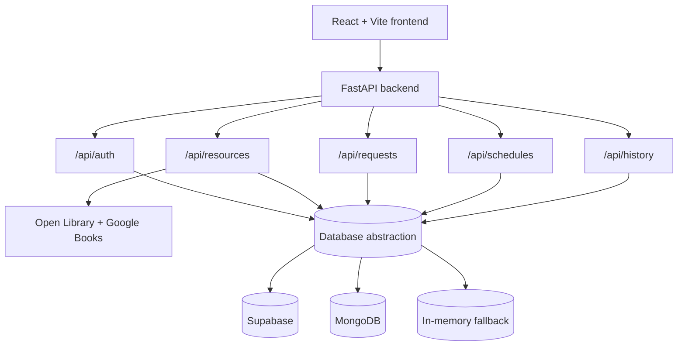

# Architecture

BookBridge uses a decoupled frontend/backend architecture. The frontend communicates with a FastAPI backend, which routes requests to the appropriate application service and persists data using the first available database backend.

## Data storage fallback order

At startup, `backend/app/database.py` attempts to connect to the following backends in order:

1. **Supabase** — used when the Supabase client and credentials are configured and reachable.
2. **MongoDB** — used when Supabase is unavailable and MongoDB is reachable.
3. **In-memory fallback** — used when neither external database is available. Data stored in this mode is temporary and is lost when the backend restarts.

The active backend is reported by the `/api/health` endpoint through the `database_type` field.

## Backend startup flow

When the FastAPI application starts, it connects to the selected database and seeds the initial dataset. On shutdown, the database manager closes the active connection.
